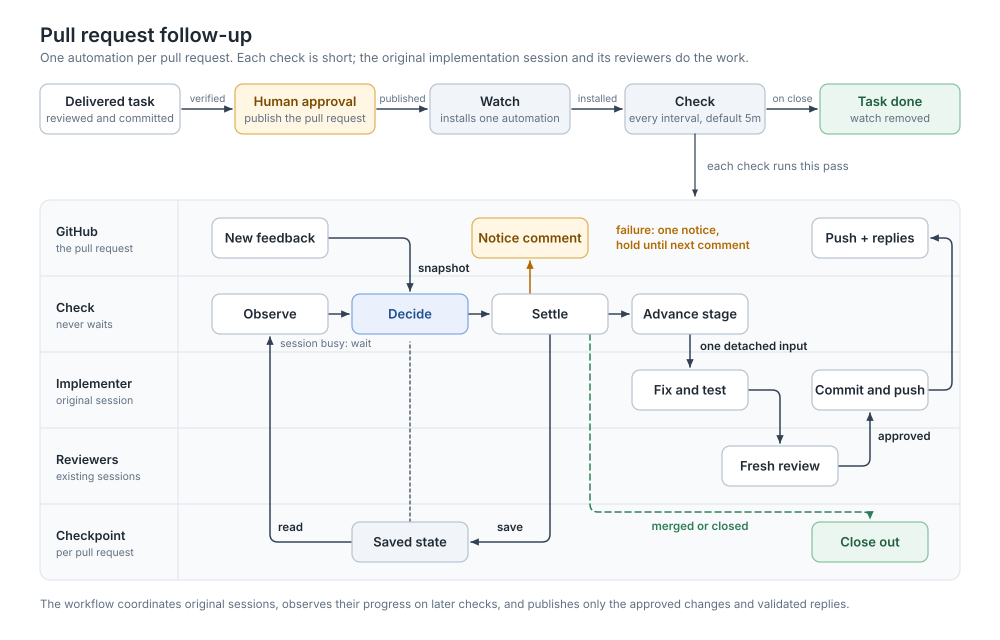

# Valdr Workflow Pack

`valdr-workflow` adds reusable task, sprint, planning, and pull-request workflows to Valdr, including follow-up on published pull requests, and a workflow-owned user tool for GitHub pull request feedback. It is a companion to the Valdr Sovereign pack.

Download both packs from the same release on [Valdr Packs releases](https://github.com/projectviking-ai/valdr-packs/releases). Use Valdr 0.4.1 as the runtime, available from [Valdr releases](https://github.com/projectviking-ai/valdr-releases/releases). Source builds and pack validation use the CLI version in [`VALDR_WORKFLOW_CLI_VERSION`](../../VALDR_WORKFLOW_CLI_VERSION) at that release tag.

| Component | Asset |
| --- | --- |
| Valdr CLI | `valdr-v<cli-version>-macos-arm64.tar.gz` and `.sha256` |
| Sovereign | `valdr-sovereign.valdr-pack.tar.gz` |
| Workflow | `valdr-workflow.valdr-pack.tar.gz` |

## Import

1. Install the Valdr runtime version above.
2. Download the Sovereign and Workflow archives from the same GitHub release.
3. In the Valdr UI pack import flow, preflight the Sovereign archive, review its plan, and commit it.
4. Preflight the Workflow archive, confirm that its core capability references resolve, review its plan, and commit it.

If either pack is already installed, keep active and frozen workflow runs intact. Use the preflight plan's update or replace operations to update definitions; do not delete the installed pack as a shortcut. The Workflow archive does not replace the core pack. Its agents reference Sovereign capabilities including `pm_workflow` and `pm_session` guidance.

## Configure a project

Before starting a workflow:

1. Attach a Git repository to a Valdr project.
2. Configure provider presets in Valdr. Use `pm_provider` with `action: list_presets` to inspect their keys and declared capabilities.
3. Register bot agents for implementation and review. Use `pm_agent` with `action: list`, `kinds: ["bot"]`, and the required role to inspect eligible handles. Routing considers declared role, tags, capabilities, usable prompt, and operator exclusions; it does not guess from a handle or model name.
4. Choose a human `operatorHandle` for correction and pull-request approval gates.

Router and sizing presets only need PM data access and must honour strict JSON output. Readiness review, implementation, code review, planning, and pull-request writing presets need repository access. The preset router uses live declared capabilities. If it cannot decide, a configured fallback is used; without one, the workflow blocks instead of launching an unknown preset. Agent routing follows the same rule for executor and reviewer defaults.

## Git and publication defaults

`idea-to-sprint` and `task.prepare-deliver-and-publish` default `remoteName` to `origin`; pass another remote name when needed. The single-task entrypoint may omit `baseRef`, in which case implementation begins from the repository's current checkout. Idea-to-sprint captures its base from the planning session and creates a deterministic plan delivery branch.

Pull requests start as drafts unless `initialDraft` is false. The writer can draft metadata from frozen commit and diff evidence, but cannot publish. The named human operator reviews the exact proposal and is the only authority that can approve publication.

## Primary entrypoints

- `valdr-workflow.idea-to-sprint`: plan an idea, execute its sprint, and publish the reviewed delivery.
- `valdr-workflow.task.prepare-deliver-and-publish`: take one written task through readiness, staffing, delivery, review, commit, and pull request, then watch the published pull request (see [PR follow-up](#pr-follow-up)). Watching needs `node` and an authenticated `gh` on the Valdr host (see [GitHub access](#github-access)), and it pushes reviewed fixes to the pull request branch and replies on the pull request without asking for approval again. The task stays `verified` until that pull request is merged or closed. Set `watchPullRequest` to `false` to publish without a watch: the task is then marked `done` as soon as the pull request is published. A rejected proposal publishes nothing and starts no watch, so the task stays `verified`.
- `valdr-workflow.pull-request.create`: publish an existing branch through a frozen-evidence approval gate.
- `valdr-workflow.pull-request.watch`: follow a published pull request, addressing owner, member, and collaborator feedback and failing checks until it is merged or closed.
- `valdr-workflow.pull-request.reinstall`: explicitly restart a removed watch for a reopened pull request, keeping its saved progress and original sessions.

Use the exact workflow versions declared in the definitions shipped with your selected pack. Validation must report zero unresolved workflow references before release. Empty executor, reviewer, and preset fallbacks deliberately block when routing returns unknown.

Task delivery launches implementation and review sessions once. Requested changes return to the same implementation session for fixes and checks. The workflow then resets the existing assignments and asks the original reviewer sessions for fresh decisions. Idle or closed sessions are resumed; a missing reviewer session blocks the revision instead of creating a replacement. Delivery allows at most three review passes.

## PR follow-up

`valdr-workflow.pull-request.watch` follows a published pull request so that feedback and failing checks are addressed without starting the task again. `task.prepare-deliver-and-publish` starts it after the operator approves the pull request, unless its `watchPullRequest` input is `false`. Start it yourself for any open pull request whose implementation session you can name. The first check treats every qualifying comment already on the pull request, including older ones, as unanswered feedback. It answers them oldest first, at most 50 per round, before it waits for new feedback, so a pull request with a long history takes several rounds. It returns as soon as the automation is installed and does not wait for feedback.

The watch installs one interval automation for the pull request. Each short check advances one saved stage: implementation, review, or publication, then returns. Later checks use session activity for best-effort follow-up while continuing to check for merge, close, or timeout. They do not read session transcripts. Start only the watch; the check and its subworkflows are internal.



The check connects four independently testable subworkflows with explicit inputs and outputs:

| Subworkflow | Responsibility |
| --- | --- |
| `pull-request.observe` | Read the checkpoint and activity summaries for the existing sessions. |
| `pull-request.decide` | Read GitHub feedback and choose the next action. |
| `pull-request.settle` | Stop active work when necessary, report failures, save progress, or finish the watch. |
| `pull-request.dispatch` | Save each stage before sending implementation or review inputs, or publishing the reviewed changes and replies. |

The dispatch records each stage before sending it. The watch allows two minutes for queued input to start. An inactive session in `idle` or `closed` state whose turn ended at or after dispatch is treated as finished. Implementation completion advances to review. Fresh decisions from every original reviewer and their finished turns advance to publication. The batch is handled only after workflow-owned publication and replies finish. Failed or unclear work holds for an explicit retry instead of being replayed automatically after a restart.

| Input | Notes |
| --- | --- |
| `projectKey` | Required. Project whose repository holds the branch. |
| `remoteName` | Defaults to `origin`. |
| `baseBranch`, `headBranch` | Required. The watch fails if the pull request is on a different head branch. |
| `prNumber` | Required. Integer. |
| `taskKey` | Required. The task the pull request delivers. It is marked `done` when the pull request is merged or closed. |
| `implementationSessionUlid` | Required. The implementation session that delivered the pull request. Rounds send feedback to this session. |
| `checkEvery` | Defaults to `5m`. A whole number of minutes, hours, or days such as `5m`, `2h`, or `1d`. `task.prepare-deliver-and-publish` accepts the same input and passes it through. |

The outputs are `outcome` (`watchable` when the automation was installed, `not_open` when the pull request was already merged or closed), `automationKey`, and `activationId`.

### What it does

- **Who counts.** Only comments from users whose repository association is `OWNER`, `MEMBER`, or `COLLABORATOR` count as feedback: conversation comments, review summaries, and inline review comments. Bots and the automation's own comments are ignored.
- **A feedback batch.** The original implementation session makes scoped changes and runs relevant checks, leaving changes uncommitted and unstaged. It writes a small implementation result, including public answers or blocker reasons, under the worktree's Git-ignored `.valdr/pr-feedback/` directory. The workflow resets the existing review assignments and sends fresh requests to the original reviewer sessions. After every reviewer approves, the workflow checks the exact reviewed tree, branch, remote head and open PR, commits and pushes normally, and publishes the validated replies. Questions and declined suggestions can finish without a code change. Missing sessions or unclear results hold the batch. The task moves through `in_progress` and `in_review`, then returns to `verified` after publication. No agent coordinates other agents, waits for reviews, or publishes the fix.
- **Visible header.** Every comment the automation posts starts with the line `🤖 Valdr workflow automation`. Each also ends with a hidden marker that identifies what it answers. The marker lets the automation find its own comments, so a retry does not post a duplicate.
- **Limits.** A round carries at most 50 feedback items, and the rest go out in later rounds. Fixing failing checks is limited to 3 consecutive attempts, with at most one check-fix round per head commit. The count resets when the checks settle green, and also when a round that answered comments completes.
- **Blocked work.** A blocked implementation result leaves the task unverified. The workflow posts its bounded public reasons for the selected feedback and holds the batch. A missing or invalid result also holds; it is never taken as success. After three review passes, unresolved requested changes hold for an explicit retry.
- **Failure and hold.** If the session fails or its lifecycle is unclear, if a round has not finished 8 hours after dispatch (active sessions are then stopped), if the head branch is unavailable, or if checks are still failing after 3 attempts, the automation posts one notice and holds. A qualifying comment posted after the hold requests a retry; comments that arrived earlier do not automatically replay the batch. Active original implementation and reviewer sessions are stopped one per check after the timeout. New feedback waits until they have stopped. An interrupted publication holds for inspection because a local commit or remote push may already have succeeded; it is never automatically repeated. A held watch still winds down when the pull request is merged or closed. The session API does not expose queued input for cancellation: after an interruption, check the existing session before requesting a retry. This is best-effort recovery, not an exactly-once guarantee.
- **Merge or close.** When the pull request is merged or closed, the check stops active original implementation and reviewer sessions, one per check. Once they have stopped, it marks the task `done` (unless it already is) and removes the automation.

#### Optional question checkpoints

The feedback tool can preserve a published question while it waits for an answer. This is opt-in: the consuming workflow chooses when to ask, publishes the question, and records it through its existing checkpoint writer. The stock watch does not create question checkpoints automatically.

Store each confirmed publication in `state.questions` with `body`, `url`, `createdAt`, `headSha`, `itemIds`, `answerAuthors`, and `checkFix`. For an inline question, also set `threadRootId` to its root review-comment ID (`rc:<id>`). `itemIds` identifies the original feedback; use an empty array for a question about checks alone. `answerAuthors` contains the GitHub logins allowed to answer. Set `checkFix` to true when the question blocks a check repair. The combined pending and in-flight question lists allow at most 10 questions and 16 KiB of JSON; each body allows 1,000 characters.

An answer must be newer, pass the existing feedback-author filter, and come from a listed answer author. It must reference the question URL, or reply in its inline thread when only one question is pending there. An unanswered check question pauses retries for its recorded head commit. Unrelated feedback and a new head can still proceed. Persist the returned `nextState`. Pass that state to `collect` to receive the question text, URL, and matching answer IDs alongside the selected feedback. The supplied dispatch workflow passes this context to the implementation session. Hidden HTML comments and control characters are removed from feedback text.

For distinct replies to one feedback item, set an optional stable `target` on each `reply.replies` entry. Use the existing target syntax, such as `notice:<number>`, and keep targets unique within that pull request. Reuse the same target after an uncertain response: the tool checks for an existing marked reply before posting again. Without a target, it continues to use the feedback item ID.

`snapshot.mergeEvidence` returns the repository, base branch, head branch, head SHA, merge commit SHA, and merge time for a merged pull request; otherwise it is null. These facts do not choose or authorize downstream completion steps. Session completion uses the best-effort lifecycle observation described above; reviewed publication is performed separately by the workflow.

## GitHub access

The `valdr-workflow.user.pr-feedback` tool runs on the Valdr host and uses the host's `node` and `gh`. It uses the host's existing `gh` login, or the `GH_TOKEN`, `GITHUB_TOKEN`, `GH_ENTERPRISE_TOKEN`, `GITHUB_ENTERPRISE_TOKEN`, `GH_HOST`, and `GH_CONFIG_DIR` environment variables that it inherits, the same way the Tools pack's CLI adapters do (see `valdr-packs/valdr-tools/README.md`). A fine-grained personal access token needs these repository permissions:

| Permission | Access | Used for |
| --- | --- | --- |
| Contents | Read and write | Pushing reviewed fixes to the pull request branch |
| Pull requests | Read and write | Reading the pull request and its reviews, and threaded replies to inline comments |
| Issues | Read and write | Conversation comments and notices |
| Checks | Read | Check runs on the head commit |
| Actions | Read | Log excerpts of failing checks |
| Metadata | Read | Required by GitHub for every token |

The token must also be able to call `GET /user`, which the tool uses to recognise its own earlier comments. Posting replies and notices fails instead of posting when that call fails, so a bare GitHub App installation token does not work.

### Stop a watch

The automation key is `valdr-workflow.pr-watch:<owner>.<repo>.<number>`, lowercased, with every character outside `a-z0-9._:-` replaced by `-`. The watch returns it as `automationKey`. To stop following a pull request:

1. Call `pm_automation` with `action: get` and `params: { key }` and note the `activationId`.
2. Call `pm_automation` with `action: remove` and `params: { key, expectedActivationId, clientRequestId }`, where `clientRequestId` is a fresh value from `pm_generate_ulid`.

Removing the automation stops future checks. Stop any active implementation or reviewer session separately with `pm_session` `abort` if needed. The task is not marked `done` when you remove a watch yourself.

### Reinstall a removed watch

After reopening the pull request, read its removed watch with `pm_automation` `get`. Start `valdr-workflow.pull-request.reinstall` with that watch's `automationKey` and `expectedActivationId`. It requires the selected watch to be removed with no running check, confirms the original pull request is open, and reuses the saved schedule, definition, and sessions. It restores the previous checkpoint so handled feedback stays handled. It does not restart a task or create sessions.

Ordinary watch installation never revives a removed watch. Recreation and checkpoint restoration are separate steps. If restoration is interrupted, pause the new activation with `pm_automation` `pause` and inspect the original reinstall run before retrying its restore step. Resume only after the checkpoint is restored; do not start another reinstall or clear its saved state.

### Known limitations

- The feature needs a Valdr CLI and runtime that provide `pm_automation` (0.4.1).
- Running the watch again for the same pull request with different inputs fails. Reinstalling a removed watch uses its saved inputs; it does not change its schedule or session bindings.
- If a push fails after the agent committed, the commit stays local and unpushed. The agent is instructed to stop and report the blocker; the watch does not independently verify a push or guarantee that later rounds stay blocked. Inspect the existing worktree before retrying.
- A pull request that is already merged or closed when the watch runs is not watched, and the task stays `verified`.
- A pull request from a fork cannot be watched: the watch fails as for a head branch mismatch.
- A check run that blocks (for example, when the host restarts in the middle of a step) holds the automation, and later ticks are skipped, until an operator cancels that run.
- Starting a watch yourself only works for a Valdr task branch whose implementation session still has its linked worktree.
- A round that has not finished 8 hours after it was started is cancelled and reported as stalled, even if it would have finished later. Comment on the pull request to retry.

## Verdandi authoring references

The [workflow reference library](reference/README.md) provides an overview plus
focused capabilities for built-in Valdr actions, Command, Git, GitHub, and
installed user tools. Verdandi loads these as needed alongside its workflow
authoring, operating, and debugging references. Each tool guide documents inputs,
result mappings, execution effects, prerequisites, and recovery limits.

See the [capability matrix](orchestrator/verdandi/ORCHESTRATOR_CAPABILITY_MATRIX.md)
for bindings and the [evaluation harness](../../evals/README.md) for isolated
workflow-authoring and Task Repairer suites through the installed `valdr` CLI.

## Validate from source

Set `VALDR_BIN` to the exact compatible CLI, then run:

```bash
make validate-valdr-workflow VALDR_BIN=/path/to/valdr
```
