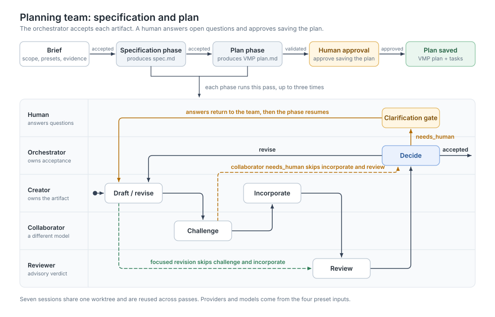

# Specification and planning team

Create a reviewed specification and a VMP-ready implementation plan from an existing Valdr task. Seven agents draft, challenge, revise and review the documents. The orchestrator accepts them autonomously and asks the operator only about requirements or decisions the available evidence cannot settle.

This workflow produces planning artifacts. It does not implement the plan.

## Start the workflow

Import the Workflow pack and start `valdr-workflow.planning-team.spec-and-plan` with:

```json
{
  "taskKey": "PROJECT-123",
  "orchestratorPresetKey": "your-orchestrator-preset",
  "creatorPresetKey": "your-sol-preset",
  "collaboratorPresetKey": "your-opus-preset",
  "reviewerPresetKey": "your-reviewer-preset"
}
```

The four preset keys select the provider, model and reasoning settings. Each creator, collaborator and reviewer preset is used for both the specification and plan phases. Choose different models for creators and collaborators, such as SOL and Claude Opus. The workflow does not pin models.

Before starting:

- The task's project must have a linked repository.
- The orchestrator preset must enable worktree creation. All seven sessions share that worktree.
- The launcher must provide repository access and Valdr MCP tools. For unattended Claude runs, configure the selected preset with `permissionMode: auto` so agents can write their assigned documents.
- The registry must include `valdr.planner.freya.schema` and `valdr.planner.freya.tasks`, supplied by the Valdr pack. These capabilities provide the VMP format and standalone task-writing requirements.

## Team and flow

| Agent | Role | Owns |
| --- | --- | --- |
| `planning-team-orchestrator` | orchestrator | `brief.md`, `spec-decision.md`, `plan-decision.md` |
| `planning-spec-creator` | planner | `spec.md` |
| `planning-spec-collaborator` | planner | `spec-collaboration.md` |
| `planning-spec-reviewer` | reviewer | `spec-review.md` |
| `planning-plan-creator` | planner | `plan.md` |
| `planning-plan-collaborator` | planner | `plan-collaboration.md` |
| `planning-plan-reviewer` | reviewer | `plan-review.md` |



The orchestrator establishes the brief, then runs specification and plan phases in order. Each phase follows creator → collaborator → creator revision → independent reviewer → orchestrator decision. Reviewer recommendations inform acceptance; the orchestrator makes the final decision.

A focused correction returns only to the creator, reviewer and orchestrator. Broader changes repeat the full phase. Optional editorial suggestions alone do not require another pass. The original task and explicit operator answers remain authoritative throughout.

When evidence cannot resolve a requirement or decision, the operator receives a Questions gate with the relevant documents. Answers become requirements for the next pass; answering does not itself accept the document. A collaborator's escalation goes to the orchestrator first. Each brief or document cycle allows three total passes, including clarification passes, before blocking.

The orchestrator accepts the specification and plan autonomously. A separate approval gate shows both artifacts and decisions before saving the accepted plan to VMP. The operator who started the run approves or rejects saving. Rejection leaves the documents in the worktree. If planning exposes an accepted specification that must change, the workflow asks the operator; it does not automatically roll back into the specification phase.

## Output

Artifacts are written under `projects/<canonical-task-key>/` in the shared worktree. Successful output includes:

- `specPath` and `planPath` for the specification and implementation plan.
- `specDecisionPath` and `planDecisionPath` for the acceptance decisions.
- `sourceSessionUlid` and `orchestratorSessionUlid` for locating the shared worktree.
- `taskKey` and the saved VMP `planKey`.

The plan includes linked requirements, concrete tasks, file targets, prerequisites, acceptance criteria and runnable checks. The creator and workflow validate the current plan before acceptance. Essential execution context stays in each task so it remains available when VMP creates tasks. Executing those tasks belongs to a later workflow.
